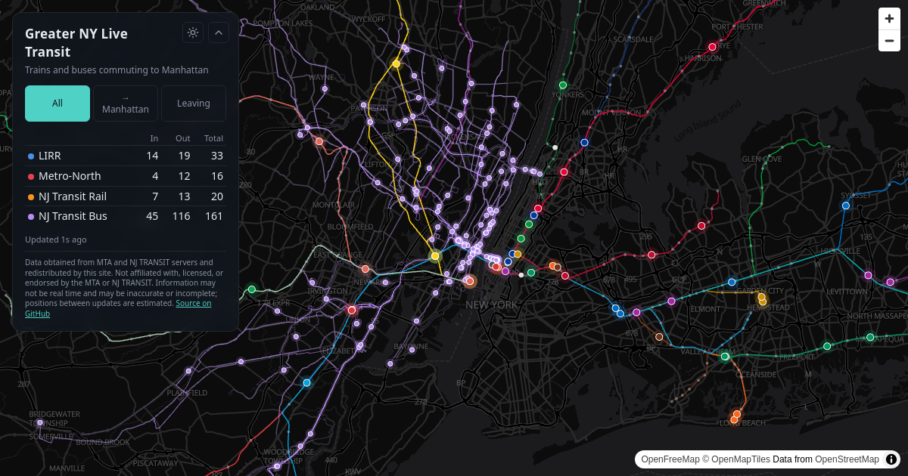

# Greater NY Live Transit

**Live: https://greater-ny-transit.vercel.app**

A live map of the trains and buses that carry commuters into and out of Manhattan — LIRR, Metro-North,
NJ Transit rail and NJ Transit bus — drawn as dots moving along their routes. Hover a vehicle for its
train or route number, destination, next stop and delay; its route lights up.



Non-commercial hobby project, built to run at $0. Data from the MTA and NJ TRANSIT; not affiliated with
or endorsed by either, and information may not be real time.

## How it works, briefly

- Agency real-time feeds are rough (LIRR positions are often minutes old, NJ Transit train positions jump
  kilometers at a time), so vehicles are snapped onto their tracks and animated toward each next stop's
  predicted arrival rather than drawn at their raw positions.
- A daily GitHub Actions job rebuilds schedule data; a FastAPI app on Vercel serves live positions,
  cached at the CDN. NJ Transit data is fetched into one shared snapshot at most every 30 seconds, so
  visitor traffic never multiplies calls to NJ Transit.

## Quick start

```bash
python3 -m venv .venv
.venv/bin/pip install -r requirements-dev.txt
cp .env.example .env                       # NJ Transit developer credentials
.venv/bin/python scripts/build_static.py   # download schedules, build map data
.venv/bin/uvicorn transit.dev:app --reload --port 8765
```

Open http://localhost:8765. Run tests with `.venv/bin/python -m pytest`.

## Docs

See [doc/](doc/README.md): architecture, data sources and their quirks, development, deployment, roadmap.
